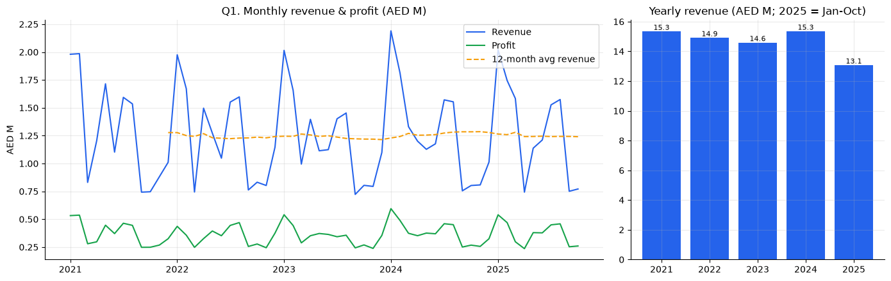
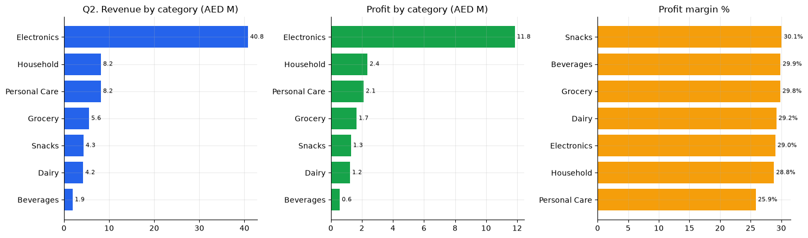
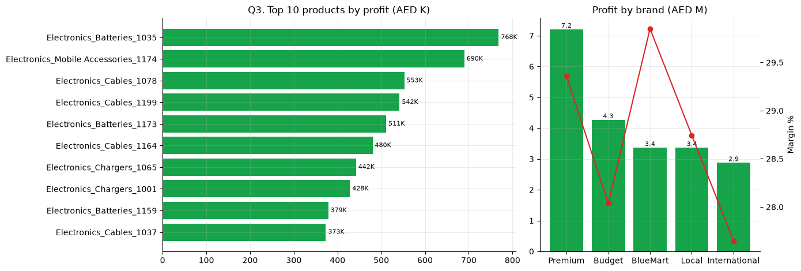
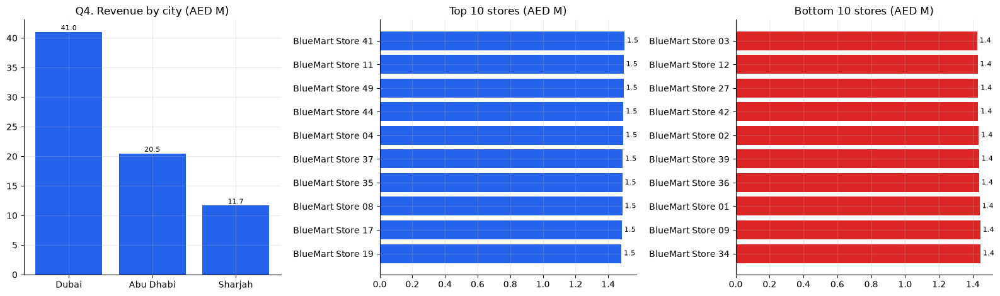
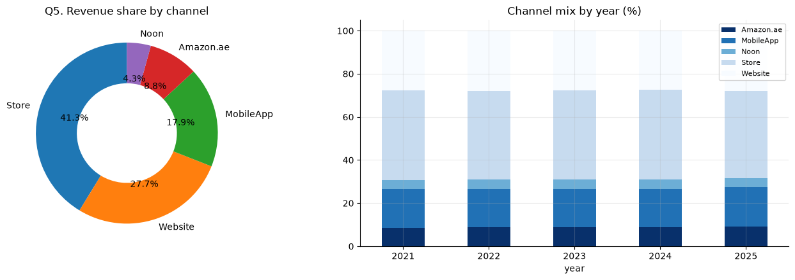
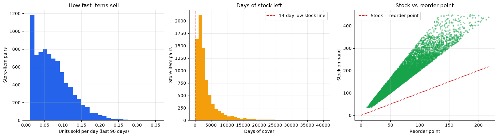
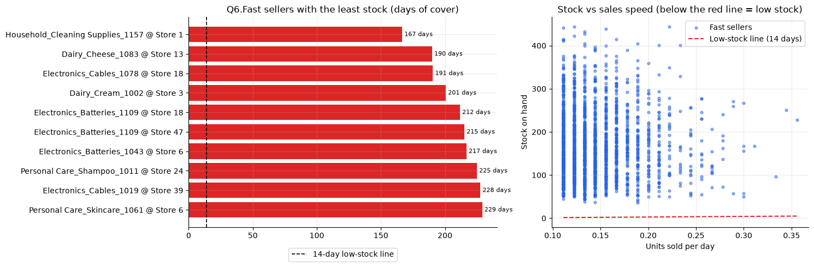
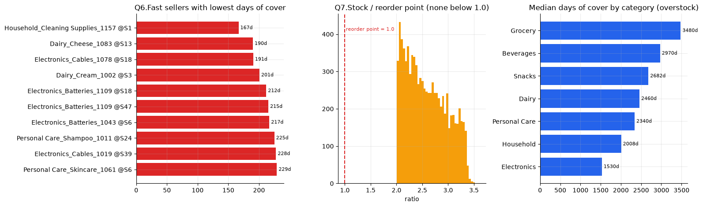
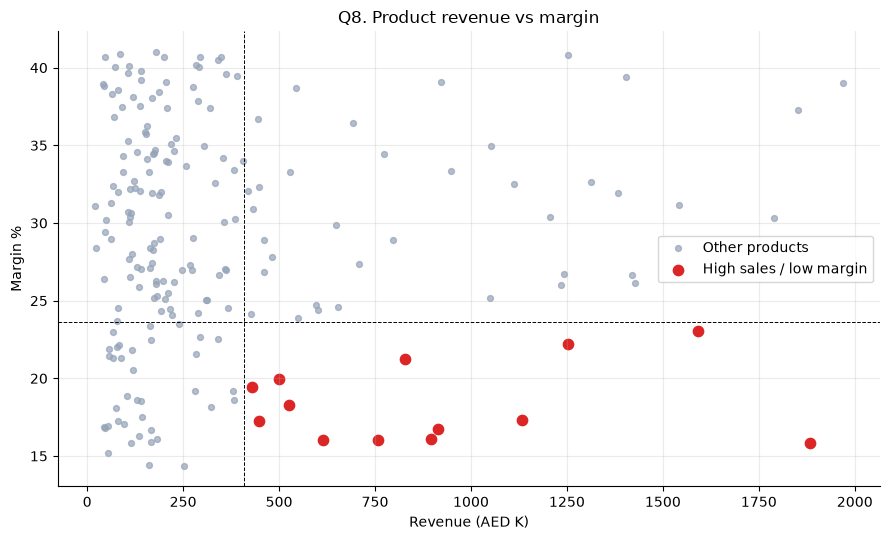
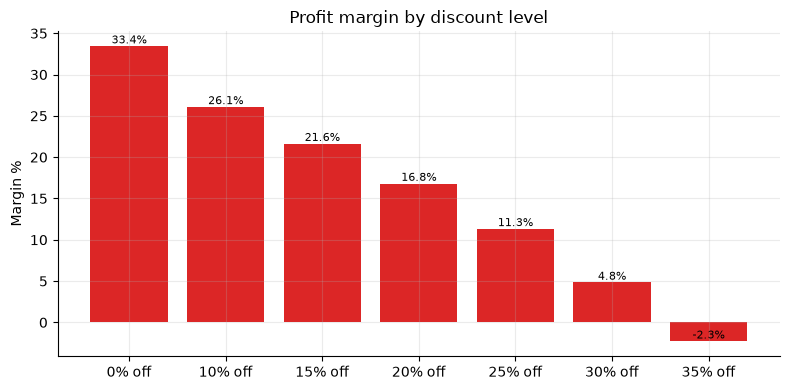

<div align="center">

# 🛒 BlueMart Retail Sales Analysis

**Sales, profit and inventory analysis of a UAE retail chain: 641,798 transactions, 50 stores, 200 products, 5 channels.**


</div>

---

## 📌 Overview

BlueMart sells groceries, household goods, personal care and electronics through physical stores, its own website and mobile app, and two online marketplaces. This project takes four raw CSV files, cleans and merges them, and answers **8 business questions** about growth, profitability, stores, channels and inventory, then turns every finding into an action.

Every step is written in plain, simple code with a short written **Answer** under each question, so the notebook can be read by both analysts and non-technical managers.

## 📊 Headline numbers

| Revenue | Profit | Profit margin | Transactions | Period |
|:---:|:---:|:---:|:---:|:---:|
| **AED 73.2M** | **AED 21.1M** | **28.8%** | **641,798** | Jan 2021 to Oct 2025 |

## 🖥️ Interactive dashboard

A one-page interactive dashboard built from the same analysis  with four tabs (Overview, Products, Stores, Inventory) and filters for year, city, category and channel.

**👉 Open the dashboard [`dashboard/index.html`](dashboard/index.html) in any browser.

---

## Business problem

BlueMart's revenue has been flat for five years. The management team needs to know:

1. How are sales changing over time?
2. Which categories generate the highest sales and profit?
3. Which products or brands are the most profitable?
4. Which stores and cities are performing best?
5. Which sales channels contribute the most revenue?
6. Which high-selling products have low inventory?
7. Which products are below their reorder point?
8. Which products have high sales but low profit?

## Key results at a glance

| Metric | Result |
|---|---|
| Transactions analysed | 641,798 (after removing 45 duplicates) |
| Revenue / profit / margin | AED 73.2M / AED 21.1M / 28.8% |
| Yearly revenue | Flat at about AED 15M; 2024 the only growth year (+5.3%) |
| Biggest category | Electronics: 55.7% of revenue, 56.2% of profit |
| Weakest margin category | Personal Care (25.9%) |
| Biggest city | Dubai: 56.1% of revenue |
| Biggest channel | Physical stores: 41.3% (Website 27.7%, MobileApp 17.9%) |
| Margin: full price vs discounted | 33.4% vs 19.8% (negative at 35% off) |
| High-sales, low-margin products | 13 products with 16% to 23% margin |
| Items below reorder point | 0 of 8,735 (median stock covers about 2,340 days) |

## Dataset

Four CSV files go in the `data/` folder (the full data dictionary is in [`data/README.md`](data/README.md)):

| File | Rows | Content |
|---|---:|---|
| `bm_sales.csv` | 641,843 | One row per sales line (Jan 2021 to Oct 2025): store, product, customer, quantity, price, channel, discount |
| `bm_skus.csv` | 200 | Product catalogue: category, subcategory, brand, list price, cost price |
| `bm_stores.csv` | 50 | Store name, city, store type, opening date |
| `bm_inventory.csv` | 8,735 | Stock snapshot (31 Oct 2025): stock on hand, reorder point, safety stock |

## Approach

```
Load  →  Inspect  →  Clean  →  Merge  →  8 business questions  →  Inventory & discount insights
```

1. **Inspection:** checked size, missing values, duplicates, unknown store or product keys, price and total mismatches, and cost against selling price.
2. **Cleaning:**

   | Issue | Rows | Action |
   |---|---:|---|
   | Exact duplicate sales rows | 45 | Removed |
   | Blank `customer_id` | 159,821 | Kept, because these are guest checkouts |
   | Unknown SKU or store, `quantity x price` mismatch, cost above price, duplicate inventory pairs | 0 | No action needed |

3. **Merge:** joined sales with product and store details, then added `revenue`, `cost`, `profit`, `year` and `month`.
4. **Analysis:** `groupby` summaries and charts for each question, plus an extra look at discounts and margin.
5. **Recommendations:** turned every finding into an action.

**Definitions used**

| Term | Definition |
|------|------------|
| Revenue | `total_value` (the sales `unit_price` is already after discount) |
| Profit | Revenue minus `quantity x cost_price` |
| Fast seller | Store-item pair at or above the 80th percentile of daily units sold (last 90 days) |
| Low stock | Fewer than 14 days of cover (`stock_on_hand / daily units`) |
| High sales, low profit | Top 25% by revenue and bottom 25% by margin |

These settings (`FAST_SELLER_PERCENTILE`, `LOW_STOCK_DAYS`, `RECENT_DAYS`) can be changed at the top of the notebook.

## Findings and recommendations

### Q1. How are sales changing over time?
Sales have barely moved in five years. Yearly revenue is about **AED 15M** (2021: 15.3M, 2022: 14.9M, 2023: 14.6M, 2024: 15.3M). 2024 was the only growth year (**+5.3%**). 2025 looks like a **-14.8%** drop, but the data stops in October. Comparing the same Jan to Oct months, 2025 is only **3.4%** below 2024.



**Action:** stop expecting growth from volume alone. Set targets for specific levers (digital channels, non-Electronics categories) and always compare Jan to Oct against Jan to Oct.

### Q2. Which categories generate the highest sales and profit?
**Electronics** is more than half of the business: **55.7%** of revenue and **56.2%** of profit. Household and Personal Care follow with 11.2% of revenue each. **Personal Care** has the weakest margin (**25.9%**); every other category sits between 28.8% and 30.1%.

| Category | Revenue (AED M) | Profit (AED M) | Margin | Revenue share |
|---|---:|---:|---:|---:|
| Electronics | 40.8 | 11.8 | 29.0% | 55.7% |
| Household | 8.2 | 2.4 | 28.8% | 11.2% |
| Personal Care | 8.2 | 2.1 | 25.9% | 11.2% |
| Grocery | 5.6 | 1.7 | 29.8% | 7.6% |
| Snacks | 4.3 | 1.3 | 30.1% | 5.9% |
| Dairy | 4.2 | 1.2 | 29.2% | 5.8% |
| Beverages | 1.9 | 0.6 | 29.9% | 2.6% |



**Action:** protect Electronics, but reduce dependence on it by growing the other categories, and review Personal Care pricing and supplier costs.

### Q3. Which products or brands are most profitable?
All of the **top 10 products by profit are Electronics** (batteries, cables, chargers, mobile accessories). **Premium** is the most profitable brand (AED 7.2M profit). Brand margins are close together (**27.6% to 29.9%**), and the BlueMart own brand has the best margin (29.9%).

| Brand | Profit (AED M) | Margin |
|---|---:|---:|
| Premium | 7.2 | 29.4% |
| Budget | 4.3 | 28.0% |
| BlueMart | 3.4 | 29.9% |
| Local | 3.4 | 28.7% |
| International | 2.9 | 27.6% |



**Action:** keep the top Electronics products always in stock, and grow the BlueMart own brand, which earns the best margin.

### Q4. Which stores and cities are performing best?
**Dubai** brings in **56.1%** of revenue, Abu Dhabi 28.0% and Sharjah 15.9%. The three store formats earn almost the same per store (about **AED 1.46M**), so the gaps between stores come mostly from city and store age, not format.

| Store format | Stores | Revenue per store |
|---|---:|---:|
| Mall | 22 | AED 1.47M |
| High Street | 18 | AED 1.46M |
| Community | 10 | AED 1.46M |



**Action:** study what the bottom 10 stores have in common (age, location, product range) before changing anything, and do not choose new store formats on revenue alone.

### Q5. Which sales channels contribute the most revenue?
**Physical stores** lead with **41.3%** of revenue, then the **Website (27.7%)** and **MobileApp (17.9%)**; together the Website and MobileApp bring about 46%. The marketplaces are small (Amazon.ae 8.8%, Noon 4.3%) and earn slightly lower margins (28.1% to 28.3% vs 29.5% in stores). Online baskets are bigger than store baskets (about AED 116 to 120 vs AED 110 per line).

| Channel | Revenue (AED M) | Share | Margin |
|---|---:|---:|---:|
| Store | 30.2 | 41.3% | 29.5% |
| Website | 20.3 | 27.7% | 28.4% |
| MobileApp | 13.1 | 17.9% | 28.3% |
| Amazon.ae | 6.5 | 8.8% | 28.3% |
| Noon | 3.1 | 4.3% | 28.1% |



**Action:** invest in the Website and MobileApp, which are already close to half of revenue, and review marketplace fees and terms.

### Q6. Which high-selling products have low inventory?
**None.** The notebook measures how fast each item sells in each store over the last 90 days and divides stock by that speed. Of 8,735 store-item pairs, 591 had no sales in the period, and **2,016 are fast sellers** (at least 0.11 units a day). Of those, **0** have less than 14 days of stock; even the fastest sellers have at least about **167 days** of stock. The table in the notebook is a *relative* watchlist (lowest cover first), not a real shortage list.





**Action:** no urgent restocking is needed. Use the watchlist only as a way to see which fast sellers to monitor first.

### Q7. Which products are below their reorder point?
**None.** **0 of 8,735** store-item pairs are below their reorder point or their safety stock. Every item holds at least **2x** its reorder point, and the median item covers about **2,340 days** of current sales. BlueMart's real issue is **overstock**, especially in Grocery (3,480 days) and Beverages (2,970 days).

| Category | Median days of cover |
|---|---:|
| Grocery | 3,480 |
| Beverages | 2,970 |
| Snacks | 2,682 |
| Dairy | 2,460 |
| Personal Care | 2,340 |
| Household | 2,008 |
| Electronics | 1,530 |



**Action:** reduce purchasing in Grocery, Beverages and Snacks to free up cash, and check that the inventory file is on the same scale as the sales data (see Limitations).

### Q8. Which products have high sales but low profit?
**13 products** are in the top 25% by revenue (at least AED 409,751) and the bottom 25% by margin (at most 23.6%). They are mostly Electronics chargers, cables and mobile accessories, plus some Personal Care items. They sell well but earn only **16% to 23%** margin.



**Action:** these 13 products are the first candidates for repricing, supplier renegotiation or fewer discounts.

### Bonus: Do discounts hurt margin?
Yes, strongly. Discounted sales earn **19.8%** margin against **33.4%** at full price, and discounted sales are about a third (34%) of revenue. Margin falls with every step of discount and turns **negative at 35% off**.

| Discount | Margin |
|---|---:|
| 0% | 33.4% |
| 10% | 26.1% |
| 15% | 21.6% |
| 20% | 16.8% |
| 25% | 11.3% |
| 30% | 4.8% |
| 35% | -2.3% |



**Action:** cap discounts at about 20% and stop discounts of 30% or more, where margin is below 5%.

## Priority recommendations

1. **Review the discount policy.** Cap discounts at about 20% and stop deep discounts (30% or more).
2. **Fix the 13 low-margin best-sellers** with price changes, better supplier terms or fewer promotions.
3. **Reduce purchasing** in overstocked categories (Grocery, Beverages, Snacks) to free up cash.
4. **Reduce dependence** on Electronics and on Dubai by growing the other categories and cities.
5. **Invest in the Website and MobileApp,** which already bring close to half of revenue.


## Next steps

- Forecast monthly sales with a time-series model to plan stock and targets.
- Segment known customers (for example by recency, frequency and spend).
- A/B test a discount cap in a few stores to measure the real effect on sales and profit.
- Rebuild the inventory view with real stock records to confirm the overstock finding.
- Move the dashboard to Power BI or Streamlit for live data.

## Tools

Python, pandas, NumPy, Matplotlib, Jupyter Notebook, HTML/JavaScript, Chart.js

## License

Released under the [MIT License](LICENSE).

## Author

**Harsh Kanaujiya** | [LinkedIn](https://www.linkedin.com/in/harshkanaujiya0207) | [GitHub](https://github.com/harshkanaujiya0207) | harshkanaujiya7860@gmail.com


